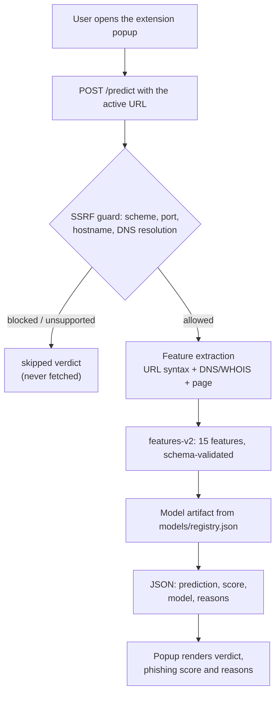

# PhishGuard AI — Phishing Detection Chrome Extension & API

> **Detect. Explain. Protect.**

A real-time phishing triage system: a lightweight Chrome extension asks a
Flask API to analyse the current page, and the API answers with a verdict, the
model's own probability, and the **feature-level reasons** behind it — not a
black-box yes/no.

**Status — milestone P2 (reproducible ML pipeline).** Training, evaluation and
serving all run on one 15-feature contract (`features-v2`) with leakage-free,
domain-disjoint evaluation. Every metric quoted below was reproduced from this
repository — see [`docs/METHODOLOGY.md`](docs/METHODOLOGY.md) for the protocol
and [`docs/threat-model.md`](docs/threat-model.md) for the security posture.

## Live API

| | |
|---|---|
| Base URL | `https://phishguard-api-ttou.onrender.com` |
| Health | [`/health`](https://phishguard-api-ttou.onrender.com/health) |
| Deploy | Render Blueprint ([`render.yaml`](render.yaml)), auto-deployed from `main`, free instance |

```bash
curl -s https://phishguard-api-ttou.onrender.com/predict \
  -H 'Content-Type: application/json' \
  -d '{"url":"http://secure-paypal-verify.account-check.top/signin"}'
# {"model":"random_forest.joblib","prediction":1,"score":1.0,"reasons":[...]}
```

Two operational notes for the free instance: it **sleeps after ~15 minutes** of
inactivity (first request then pays a ~50 s cold start — a `.github/workflows/warmup.yml`
schedule pings `/health` to keep it warm, which consumes ~730 of the 750 free
instance-hours a month, so the account has room for this service only), and it
is sized at 512 MB / 0.1 CPU, which is why the blueprint runs a single gunicorn
worker with `MODEL_NAME=lightgbm.joblib` as the drop-in lever if latency ever
matters.

End-to-end verification against a deployment:

```bash
PHISHGUARD_LIVE_URL=https://phishguard-api-ttou.onrender.com \
  python -m pytest tests/test_live_api.py -v
```

---

## How it works



---

## Highlights

* **Explainable verdicts** — `/predict` returns `reasons[]` derived from the
  exact feature vector the model scored; unavailable signals are reported as
  unavailable instead of silently guessed.
* **Four shipped models** — Random Forest (default), XGBoost, LightGBM and
  Logistic Regression, switchable at boot with `MODEL_NAME` (no code change).
* **Hardened API** — SSRF-guarded outbound fetching, sliding-window rate
  limiting, structured errors without stack traces, origin allowlist instead
  of open CORS, optional API key, URLs never logged.
* **Honest evaluation** — three split protocols (leaked baseline, primary
  domain-disjoint, stress-test vector-disjoint), Wilson confidence intervals,
  and explicit baselines so accuracy is never quoted without context.
* **Reproducible to the digit** — `train_model.py --check` refits all 24
  experiments and asserts the committed metrics reproduce within `1e-6`.

## Features extracted (features-v2 — 15 columns)

| Group | Features |
|---|---|
| URL syntax (8) | `Have_IP`, `Have_At`, `URL_Length`, `URL_Depth`, `Redirection`, `https_Domain`, `TinyURL`, `Prefix/Suffix` |
| Domain (3) | `DNS_Record`, `Domain_Age`, `Domain_End` |
| Page (4) | `iFrame`, `Mouse_Over`, `Right_Click`, `Web_Forwards` |

* Legacy `Web_Traffic` was **removed**: its Alexa source was discontinued in
  2022 and cannot be served. Forcing it to the only available value costs
  3.8–4.4 accuracy points (measured — [`docs/METHODOLOGY.md` §6.2](docs/METHODOLOGY.md)).
* `Have_IP` is now evaluated against the **hostname** (the legacy whole-URL
  check could never succeed).
* Domain/page features are best-effort: some are `1` both when a pattern was
  observed *and* when the lookup failed. The API says which signals were
  missing rather than pretending otherwise.

## Model performance

Primary protocol `domain_disjoint` (zero domain overlap), seed 42, n = 878
test rows (772 phishing / 106 legitimate), features-v2:

| Model | Accuracy | F1 | ROC-AUC | FPR | p95 latency |
|---|---|---|---|---|---|
| `random_forest` (**default**) | **0.7472** | **0.8360** | 0.8496 | 0.1509 | 108 ms |
| `xgboost` | 0.7255 | 0.8181 | 0.8632 | 0.1038 | 15 ms |
| `lightgbm` | 0.7244 | 0.8180 | 0.8598 | 0.1321 | 6 ms |
| `logistic_regression` | 0.6948 | 0.7926 | **0.8753** | **0.0755** | 7 ms |

> **Read this honestly.** The test split is 87.9% phishing, so a classifier
> that always answers "phishing" scores 0.879 accuracy / 0.936 F1 while being
> useless, and the 15-feature representation caps out at 0.906. That is why
> the operating metrics are ranking (ROC-AUC 0.85–0.88 vs 0.5 for a constant)
> and the FPR/FNR trade-off — full reasoning and confidence intervals in
> [`docs/METHODOLOGY.md` §7](docs/METHODOLOGY.md).

---

## Quickstart

### 1. Run the API

Python 3.11+ (CI tests 3.11 / 3.12 / 3.13).

```bash
python -m venv venv
source venv/bin/activate          # Windows: venv\Scripts\activate
pip install -r requirements-dev.txt

python app.py                     # http://127.0.0.1:5000
curl http://127.0.0.1:5000/health # {"status":"ok","model":"random_forest.joblib"}
```

### 2. Run the checks

```bash
pytest -m "not network"           # 180 offline tests
ruff check .                      # lint
node --check Phishing_detection_app/chrome_extension/popup.js

python evaluate_models.py --check # rescore shipped artifacts vs metrics.json
python train_model.py --check     # refit 24 experiments, assert metrics reproduce
```

### 3. Load the Chrome extension

1. Open `chrome://extensions/` and enable **Developer mode**.
2. **Load unpacked** → select `Phishing_detection_app/chrome_extension`.
3. Pin **PhishGuard**, open a page, press **Scan Current Page**.

The popup calls `http://127.0.0.1:5000/predict` by default. Override without
rebuilding the extension (open the service worker console or any extension
page):

```javascript
chrome.storage.local.set({ apiUrl: "https://phishguard-api-ttou.onrender.com/predict" });
```

Point it at a local server (`http://127.0.0.1:5000/predict`) or your own
deployment instead; add `apiKey: "…"` if the server sets `API_KEY`. That
configuration is the only thing the extension persists — never page contents or
history.

A verdict shows the hard label, the model's phishing score, and up to four
reasons. Errors, timeouts, 401s and rate limits render as **"Could not
complete"** — never as "Safe" — and whitelisted / not-applicable results are
shown as their own states.

---

## API reference

### `POST /predict`

```bash
curl -X POST http://127.0.0.1:5000/predict \
  -H "Content-Type: application/json" \
  -d '{"url": "http://example-login.verify-account.top/signin"}'
```

```json
{
  "prediction": 1,
  "score": 0.9631,
  "model": "random_forest.joblib",
  "reasons": [
    "URL contains '@' - text before it is ignored by browsers",
    "No registration/DNS intelligence available for this domain",
    "Domain is under 6 months old, or WHOIS was unavailable",
    "Page inspection unavailable: the site could not be fetched (blocked, unreachable or timed out)"
  ]
}
```

* `prediction` — `0` legitimate, `1` phishing (also returned for
  whitelisted / skipped results, with `analysis` set instead of `reasons`).
* `score` — model's `P(phishing)`, **uncalibrated**, `null` when the artifact
  has no `predict_proba`.
* `reasons` — empty list means "nothing to report", which is **not** the same
  as "safe".

Errors are structured and never leak internals:

```json
{"error": {"code": "rate_limited", "message": "Too many requests, slow down", "request_id": "1f2e3d4c5b6a"}}
```

| Situation | Status |
|---|---|
| Missing/invalid `X-API-Key` (when `API_KEY` is set) | `401 unauthorized` |
| Over the per-client limit | `429 rate_limited` + `Retry-After` |
| Body not JSON / missing `url` / URL too long | `400` |
| Extracted features violate the schema | `422 schema_violation` |
| `chrome://`, `file://`, `data:` … | `200` + `{"analysis":"skipped"}` — **never fetched** |
| Whitelisted domain | `200` + `{"analysis":"whitelisted"}` |

### `GET /health`

Liveness probe used by `render.yaml`: `{"status":"ok","model":"<artifact>"}`.

---

## Configuration

Every setting defaults safely; production overrides are environment variables
only (see [`phishguard/config.py`](phishguard/config.py)):

| Variable | Default | Purpose |
|---|---|---|
| `MODEL_NAME` | `random_forest.joblib` | artifact to serve (bare filename in `models/`) |
| `API_KEY` | unset | enables `X-API-Key` auth on `/predict` |
| `RATE_LIMIT_PER_MINUTE` | `60` | sliding window per client |
| `MAX_URL_LENGTH` | `2048` | request URL cap |
| `MAX_REQUEST_BYTES` | `32768` | body cap |
| `CORS_ORIGINS` | extension + localhost | comma-separated extra origins |
| `TRUST_PROXY` | `0` | trust `X-Forwarded-For` behind a proxy you control |
| `LOG_LEVEL` | `INFO` | JSON access log level (URLs are never logged) |

## Production deployment

```bash
pip install -r requirements.txt
gunicorn --workers 1 --threads 4 --timeout 30 app:app
```

The included [`render.yaml`](render.yaml) blueprint does this for you (with
`plan: free` — bump `--workers` if you move to a paid instance). On any
internet-facing deploy: set `API_KEY`, point the extension's `apiUrl` at the
service, and keep `CORS_ORIGINS` tight. Threat model and accepted residual
risks: [`docs/threat-model.md`](docs/threat-model.md).

---

## Project structure

| Path | Role |
|---|---|
| [`app.py`](app.py) | Flask API — validation, auth, rate limiting, verdict contract |
| [`phishguard/`](phishguard/) | package: feature schema, splitting, explainability, SSRF guard, config |
| [`URLFeatureExtraction.py`](URLFeatureExtraction.py) | URL syntax + DNS/WHOIS + page extraction → features-v2 |
| [`train_model.py`](train_model.py) | trains all experiments, writes artifacts + `registry.json` |
| [`evaluate_models.py`](evaluate_models.py) | rescored shipped artifacts vs `metrics.json` (`--check` gate) |
| [`models/`](models/) | four `.joblib` artifacts, `registry.json`, `metrics.json`, [`MODEL_CARD.md`](models/MODEL_CARD.md) |
| [`tests/`](tests/) | 180 offline tests — schema, splits, registry, API, SSRF, rate limits |
| [`Phishing_detection_app/chrome_extension/`](Phishing_detection_app/chrome_extension/) | extension (`manifest.json`, `popup.html`, `popup.js`) |
| [`DataFiles/`](DataFiles/) | dataset CSVs + [`DATASETS.md`](DataFiles/DATASETS.md) (measured stats, provenance) |
| [`docs/`](docs/) | [`METHODOLOGY.md`](docs/METHODOLOGY.md), [`threat-model.md`](docs/threat-model.md) |

## Documentation

| Document | What it settles |
|---|---|
| [`docs/METHODOLOGY.md`](docs/METHODOLOGY.md) | dataset distortions, split protocols, all measured results, baselines, reproducibility, limitations |
| [`docs/threat-model.md`](docs/threat-model.md) | trust boundaries, threats ↔ mitigations ↔ tests, accepted residual risks |
| [`models/MODEL_CARD.md`](models/MODEL_CARD.md) | artifact provenance, schema, performance, serving guidance |
| [`DataFiles/DATASETS.md`](DataFiles/DATASETS.md) | file inventory, measured statistics, provenance/licence gaps |

## Continuous integration

`CI` runs on every PR: `ruff`, the offline test matrix (Python 3.11–3.13),
`pip-audit` against known CVEs, extension syntax checks, and the benchmark
gates (`train_model.py --check`, `evaluate_models.py --check`) so a metric
drift fails the build instead of shipping.
